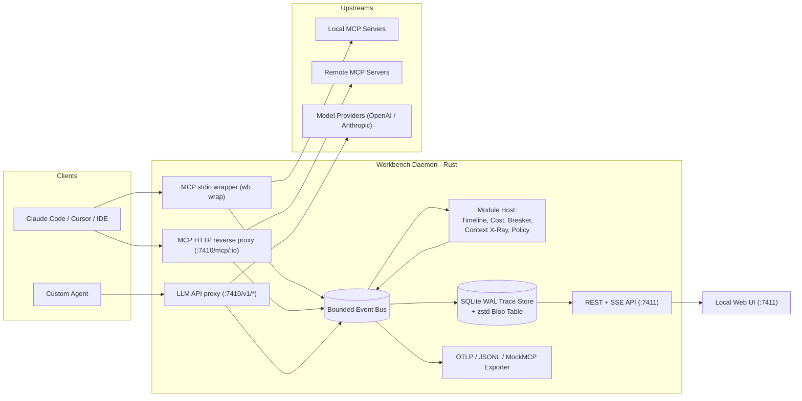

# MCP and Agent Workbench (`wb` / `wbd`)

**MCP and Agent Workbench (MCPAW)** is a local, zero-trust, low-latency proxy, flight recorder, and modular analysis shell that sits between AI agents (Claude Code, Cursor, VS Code, custom agents) and both **MCP servers** (stdio and Streamable HTTP) and **LLM provider APIs** (OpenAI-compatible and Anthropic-compatible).

> **The Inspector is a multimeter. The Workbench is a logic analyzer left clipped to the bus.**
>
> Agent failures are mostly *trajectory* failures — wrong tool chosen, right tool with wrong arguments, a runaway retry loop, or a context window that silently overflowed — rather than single-call failures. The Workbench records every model call and tool call into a unified local timeline, tracks live token costs, profiles context composition, and enforces loop/budget circuit breakers and transport-level security policies.

---

## Core Design Budgets & Invariants

1. **≤ 2 ms added p99 latency per proxied message** (at 1 KB payload; ≤ 10 ms at 1 MB).
2. **100% byte-identical stream transparency**: Proxied stdio and SSE streams are forwarded byte-for-byte without JSON re-serialization, key reordering, or chunk merging.
3. **Zero payload bytes written to disk by default**: Default capture mode is `metadata` (methods, tool names, sizes, token counts, statuses, schema hashes). Full payload capture is strictly opt-in and runs header/regex redaction *before* events reach the persistence layer.
4. **Fail-open observation, fail-closed policy**:
   - If the daemon (`wbd`) is down or crashes mid-run, `wb wrap` continues forwarding traffic between client and MCP server without interruption.
   - When the **Policy / Firewall** module is enabled (`fail_closed = true`), `wb wrap` blocks `tools/call` with an explicit JSON-RPC error if the daemon is unreachable or denies the call.

---

## Architecture



### Integrated Suite Modules

The Workbench serves as the shared proxy core and UI shell for the full local agent reliability suite:

| Module | Function |
|---|---|
| **Timeline & Catalog** | Pairs JSON-RPC requests/responses, classifies MCP protocol eras (`2024-11-05`, `2025-11-25`, `2026-07-28` stateless, or `dual`), tracks `ToolDefinition` SHA-256 hashes across runs, flags deprecated features (`roots`, `sampling`, `logging`), marks `elicitation` spans as waiting on human, and warns on suspicious tool-poisoning instructions. |
| **Cost Accounting** | Computes live per-call and per-run USD cost from provider `usage` blocks (`(input - cached) * input_price + cached * cache_price + output * output_price`) using a dated, bundled price table (with `~` fallback estimation when usage blocks are omitted). |
| **Circuit Breaker** | Stops runaway runs when per-run cost exceeds `max_run_cost_usd`, total tokens exceed `max_run_tokens`, or the agent repeats the exact same tool call + arguments more than `max_identical_tool_calls` times. |
| **Context Window X-Ray** | Profiles every LLM request's token breakdown across **System Prompt**, **Tool Definitions**, **Conversation History**, and **Tool Results**, highlighting context bloat over long trajectories. |
| **Policy / Firewall** | Enforces transport-level `allow`/`deny` rules matching server ID, tool name, and argument regex patterns, independent of agent framework. |

---

## Quickstart

### 1. Build from Source

Requires Rust 1.80+ (`cargo`):

```bash
cargo build --release
```

This produces two binaries in `target/release/`:
- `wbd` — the Workbench background daemon (proxies, event bus, SQLite WAL store, REST/SSE API, and Web UI).
- `wb` — the Workbench CLI, stdio wrapper (`wb wrap`), client config setup tool, and CI runner utility.

### 2. Start the Daemon

```bash
./target/release/wb up
```

When started, `wbd` prints the local UI launch URL containing the one-time session token:
- **Proxy Ingress (MCP HTTP & LLM APIs)**: `http://127.0.0.1:7410`
- **Web UI & REST/SSE API**: `http://127.0.0.1:7411/?token=<256-bit-token>`

### 3. Wrap an MCP stdio Server

Update your MCP client configuration (or run `wb setup claude-code` to rewrite with an automatic backup):

```json
{
  "mcpServers": {
    "invoices": {
      "command": "wb",
      "args": ["wrap", "--id", "invoices", "--", "node", "invoice-server.js"]
    }
  }
}
```

### 4. Point an Agent at the HTTP & LLM Proxies

- **Streamable HTTP MCP Server**: `http://127.0.0.1:7410/mcp/<server-id>`
- **OpenAI-compatible API**: `OPENAI_BASE_URL=http://127.0.0.1:7410/v1`
- **Anthropic-compatible API**: `ANTHROPIC_BASE_URL=http://127.0.0.1:7410`

---

## CLI Reference (`wb`)

```bash
# Start the Workbench daemon (foreground or background)
wb up [--config ~/.config/workbench/wb.toml]

# Wrap a local stdio MCP server with byte-identical forwarding
wb wrap --id <server-id> [--policy] -- <command> [args...]

# Automatically wrap/unwrap servers in a client configuration (with backup)
wb setup claude-code [--config-path <path>] [--undo]

# List discovered MCP servers and their exposed tool catalogs
wb servers [--tools] [--json]

# List recorded runs or inspect a specific run's span tree and cost
wb runs ls [--status <status>] [--since <timestamp>] [--json]
wb runs show <run-id> [--json]

# Compare two runs and highlight the first divergence
wb runs diff <left-run-id> <right-run-id> [--json]

# Export runs to OpenTelemetry (OTLP JSON), JSONL, or MockMCP Studio fixtures
wb export --format otlp|jsonl|mockmcp [--runs <id1,id2>] [--preview] [--output <file>]

# Import a JSONL run export or generate replay fixtures
wb import <file.jsonl>
wb replay <run-id> [--output <fixtures.json>]

# Test policy rules against a hypothetical tool call
wb policy test --server <server-id> --tool <tool-name> --args '{"path":"/etc/passwd"}'
```

---

## Configuration (`~/.config/workbench/wb.toml`)

```toml
[daemon]
mcp_port = 7410
ui_port  = 7411
bind     = "127.0.0.1"
idle_run_gap_secs = 30

[capture]
payloads       = "metadata"   # "off" | "metadata" | "full"
redact         = [
  "authorization",
  "api[_-]?key",
  "bearer\\s+\\S+",
  "sk-[A-Za-z0-9_-]{12,}"
]
retention_days = 14
max_db_mb      = 2048
inject_traceparent = false

[[server]]
id        = "invoices"
transport = "stdio"

[[server]]
id        = "jira"
transport = "http"
upstream  = "https://mcp.internal.example.com/jira"

[pricing]
source = "bundled"

[breaker]
enabled                  = true
max_run_cost_usd         = 5.0
max_run_tokens           = 500000
max_identical_tool_calls = 5

[policy]
enabled     = false
fail_closed = true

[[policy.rules]]
id          = "deny-outside-workspace"
server      = "filesystem"
tool        = "write_file"
arg_pattern = "^(?!.*\"/workspace/).*"
effect      = "deny"
reason      = "Filesystem writes outside /workspace are prohibited"

[export]
otlp_endpoint = ""            # Empty = disabled
```

---

## Security & Privacy Model

The Workbench handles sensitive agent traffic and enforces strict local security boundaries:

- **Loopback Binding Only**: Refuses to start on `0.0.0.0` or non-loopback interfaces unless `--i-understand-this-exposes-traffic` is explicitly passed.
- **256-Bit UI Session Token**: Generated at daemon startup, required on all `/api/*` requests via `Authorization: Bearer <token>`, `X-WB-Token`, or an `HttpOnly; SameSite=Strict` cookie exchanged via the initial launch URL.
- **DNS Rebinding & CSRF Protection**: Every request to the UI/API port validates `Host` and `Origin` against a strict loopback allowlist (`127.0.0.1`, `localhost`, `[::1]`).
- **Pre-Persistence Redaction**: Header stripping and regex redaction run *before* events enter the event bus or touch SQLite, WAL, blobs, or exports.
- **Strict File Permissions**: Database files and IPC sockets are created with `0600` permissions on Unix systems.

---

## Testing Suite

The test suite follows the priorities outlined in the Testing Approach:

1. **Transparency & Differential Byte-Identity Tests**: Runs scenarios directly and through `wb wrap` / HTTP proxy, asserting exact byte equality in both directions (including arbitrary chunk splits, UTF-8 multibyte boundaries, `\r\n` vs `\n`, notifications mid-response, and multi-megabyte payloads).
2. **Protocol Conformance Across Spec Eras**: Validates legacy (`2024-11-05`, `2025-11-25`), stateless (`2026-07-28` `_meta` and `MCP-Protocol-Version` header), and dual-era servers, plus Tasks, Elicitation, and deprecated feature badges.
3. **Security Suite**: Verifies DNS-rebinding `403` blocks, cross-origin CSRF rejection, missing/invalid token `401` responses, non-loopback bind refusal, policy fail-closed behavior when `wbd` is killed, and the **Secret Canary** test ensuring `sk-canary-...` and `Bearer canary...` never appear in SQLite, WAL, blobs, or exports across any capture level.
4. **Chaos Fixtures & Deterministic Fake LLM**: Tests `echo`, `slow`, `crashy`, `huge`, `chatty`, `liar` (schema-hash poisoning detector), `weird-schema`, and `dual` fixtures, plus scripted LLM loops and context bloat trajectories.

Run the full test suite with:

```bash
cargo test
```

---

## License

Apache License 2.0 — see [LICENSE](file:///Volumes/S%20Drive/Experiments/MCPAW/MCPAW/LICENSE).
